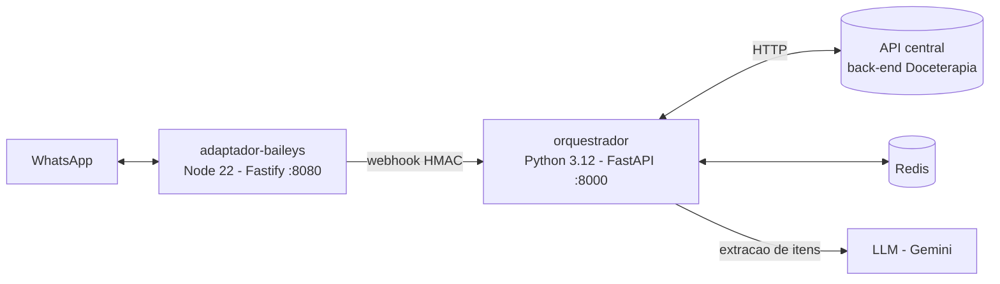

# assistente-whatsapp

Assistente de estoque no WhatsApp do sistema **Doceterapia**. Recebe mensagens de
uma beneficiária/dona autorizada em um grupo dedicado do WhatsApp, interpreta
compras com apoio de um LLM e registra o estoque na API central, além de entregar
notificações proativas. É composto por dois serviços independentes: um
**orquestrador** em Python e um **adaptador Baileys** em Node.js.

O orquestrador é um consumidor da API central (back-end); **nunca acessa o banco
de dados diretamente**. A pilha completa (banco, back-end, front-end, Redis e este
assistente) é orquestrada pelo repositório irmão
[`projeto-doceterapia/infra`](https://github.com/projeto-doceterapia/infra) via
Docker Compose, onde o `adaptador-baileys` só sobe com o perfil `baileys`. No canal
`cloud_api` o adaptador não é usado: o orquestrador fala direto com a Meta WhatsApp
Cloud API.

## Fluxo



## Serviços

| Serviço | Pasta | Stack | Porta | Responsabilidade | Detalhes |
|---|---|---|---|---|---|
| orquestrador | [`orquestrador/`](orquestrador) | Python 3.12 - FastAPI | 8000 | Conduz a conversa de compra, extrai itens via LLM, fala com a API central, mantém estado no Redis e entrega notificações proativas. | [`orquestrador/README.md`](orquestrador/README.md) |
| adaptador-baileys | [`adaptador-baileys/`](adaptador-baileys) | Node 22 - TypeScript - Fastify | 8080 | Mantém a sessão do WhatsApp (`@whiskeysockets/baileys`), filtra as mensagens para o grupo dedicado (`GRUPO_JID`) e encaminha eventos ao orquestrador por webhook assinado com HMAC-SHA256. | [`adaptador-baileys/README.md`](adaptador-baileys/README.md) |

As portas acima são os padrões; o orquestrador escuta em 8000
(`uvicorn ... --port 8000`) e o adaptador em `PORT` (padrão 8080). O detalhamento de
rotas, contrato HTTP, variáveis de ambiente e comportamento de cada serviço está nos
READMEs acima.

## Como rodar

### Pilha completa (recomendado)

Use o repositório [`projeto-doceterapia/infra`](https://github.com/projeto-doceterapia/infra),
que sobe banco, back-end, front-end, Redis e este assistente com Docker Compose
(perfil `baileys` para o adaptador). O `.env` consolidado também vive lá.

### Serviços isolados

Cada serviço roda sozinho seguindo o seu README:

- orquestrador: [`orquestrador/README.md`](orquestrador/README.md) (`uvicorn app.main:app`
  na porta 8000, ou via Docker). Sem as credenciais de canal/LLM obrigatórias o
  serviço ainda sobe servindo apenas `GET /health`; os workers não iniciam.
- adaptador-baileys: [`adaptador-baileys/README.md`](adaptador-baileys/README.md)
  (`npm ci && npm run build && npm start`, ou via Docker com `BAILEYS_ENABLED=false`
  para verificação de imagem sem conexão real com o WhatsApp).

Nenhum valor de segredo é embutido nas imagens; as tabelas de variáveis de ambiente
(com padrões e marcação de segredo) estão nos READMEs de cada serviço.

## Testes e CI

O workflow [`.github/workflows/ci.yml`](.github/workflows/ci.yml) roda em push/PR
para `main` e executa as duas suítes em um único job:

- **orquestrador**: `pip install -e '.[dev]'` e `python -m pytest -q`
  (em `orquestrador/tests/`, com unit, integração e snapshots).
- **adaptador-baileys**: `npm ci`, `npm run build` e `npm test` (`node:test`).

As imagens são publicadas no GHCR por
[`publish-orquestrador.yml`](.github/workflows/publish-orquestrador.yml) e
[`publish-adaptador-baileys.yml`](.github/workflows/publish-adaptador-baileys.yml)
em push para `main` e tags `v*.*.*`.

## Estrutura

```text
.
├── .github/workflows/        # CI (ci.yml) e publicacao das imagens no GHCR
├── orquestrador/             # servico Python (FastAPI) - ver orquestrador/README.md
└── adaptador-baileys/        # servico Node/TypeScript (Fastify) - ver adaptador-baileys/README.md
```
